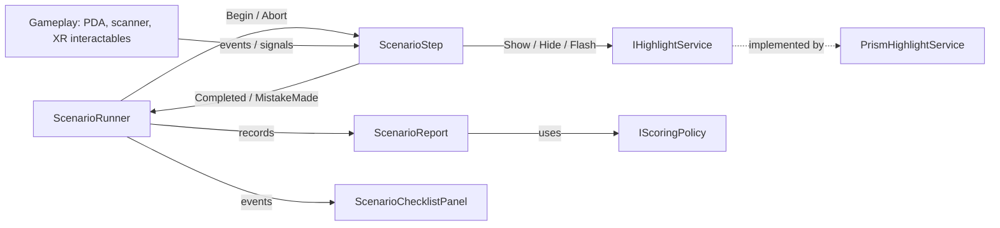

# HSE Scenario System

A small task/step framework for VR training scenarios. A scenario is a list of steps; mandatory steps open one at a time, each only after the previous one is completed, while optional steps stay open in the background for bonus points. The active step's objects are highlighted (with [PrismFX Highlight](https://github.com/endererolwork/PrismVFX-Highlight)), and the highlight switches off when the step is done.

```
Assets/HSE/Scenario/
  Core/      HSE.Scenario           runner, step base, composite, signals, report   (no dependencies)
  PrismFX/   HSE.Scenario.PrismFX   IHighlightService adapter for PrismFX           (Core + PrismFX)
  Tests/     HSE.Scenario.Tests     PlayMode tests for the runner and scoring
Assets/HSE/Scripts/Training/
  Steps/     game-specific steps (grab, interact, reach location, scan wristband, confirm identity, lab order)
  UI/        wrist checklist panel
```

## How it fits together



1. `ScenarioRunner.StartScenario()` resets every step, starts the optional ones, then begins the first mandatory step.
2. `ScenarioStep.Begin()` lights up its targets and calls `OnBegin()`, where the subclass starts listening.
3. When its condition is met, the step calls `Complete()`. That turns the highlight off, calls `OnEnd()` and raises `Completed`.
4. The runner books the result and begins the next mandatory step. When none are left, it closes the optional steps and raises `ScenarioCompleted` with the report.
5. Wrong actions call `ReportMistake()`: the targets flash red and the mistake is recorded. The step stays open.

## Writing a new step

Subclass `ScenarioStep`, start listening in `OnBegin`, stop in `OnEnd`, call `Complete()` when done:

```csharp
public class PlaceInBinStep : ScenarioStep
{
    [SerializeField] Collider bin;
    [SerializeField] Collider specimenBag;

    protected override void OnBegin() => BinTrigger.Entered += OnEntered;
    protected override void OnEnd()   => BinTrigger.Entered -= OnEntered;

    void OnEntered(Collider c)
    {
        if (c == specimenBag) Complete();
        else ReportMistake("Wrong item in the transport bin.");
    }
}
```

No other class has to change. For simple "do X" tasks you don't even need a class: create a `ScenarioSignal` asset, call `signal.Raise()` from gameplay code, and add a `SignalStep` that completes on it.

Small mandatory sub-tasks go in a `CompositeStep` (`InSequence` or `AnyOrder`). The runner treats it like any other step. Mistakes in sub-tasks count against the parent.

## Design notes (SOLID)

| Principle | Where |
|---|---|
| **Single responsibility** | A step only decides when it is done. The runner only sequences. `ScenarioReport` only records. `IScoringPolicy` only scores. The checklist panel only draws. |
| **Open/closed** | New tasks are new `ScenarioStep` subclasses (or `SignalStep` + an asset). The runner, report and UI stay unchanged. |
| **Liskov substitution** | The runner works with any `ScenarioStep`, including `CompositeStep`, which is itself a step made of steps. |
| **Interface segregation** | Steps get an `IScenarioContext` (highlighter + clock), not the whole runner. The report depends on `IStepInfo`, not on MonoBehaviours. |
| **Dependency inversion** | Steps call `IHighlightService`. PrismFX is plugged in by one adapter (`PrismHighlightService`); without it, the `NullHighlightService` is used. Tests use a recording fake. |

Other patterns: Observer (runner events, `ScenarioSignal`), Composite (`CompositeStep`), Null Object (`NullHighlightService`), Strategy (`IScoringPolicy`), Template Method (`Begin` → `OnBegin`, `Complete` → `OnEnd`).

## Scoring

`DefaultScoringPolicy`: a mandatory step gives its points minus 2 per mistake (never below 0). An optional step adds its points as a bonus. Max score counts mandatory steps only. A skipped step gives 0. Swap the policy by passing another `IScoringPolicy` to `ScenarioReport`.

## The training scenario in this project

`HSE > Setup Scenario` builds "Blood Collection and Lab Request" in the patient room. It starts when the trainee picks English or Turkish on the panel at the entrance. A bobbing arrow with a short prompt sits above the current target, and a direction arrow appears in front of the trainee while the target is out of view (`ScenarioGuide`). Step text is localised through `HSE.Localization.Loc` with keys `step.<id>.title|instr|cue`; the step's own fields are the English fallback.

| # | Step | Type | Highlight |
|---|---|---|---|
| 1 | Pick up the PDA | `GrabStep` | PDA |
| 2 | Go to the bedside | `ReachLocationStep` | bed (hint) |
| 3 | Scan the wristband | `ScanWristbandStep`; a wrong code or wrong patient is a mistake | wristband + QR |
| 4 | Confirm identity on the PDA | `ConfirmIdentityStep` | PDA |
| 5 | Hand hygiene, then gloves | `CompositeStep` (in sequence) of two `InteractStep`s | dispenser, then glove box |
| 6 | Blood pressure: cuff on the arm, NIBP START on the monitor, record on the PDA | `CompositeStep` (in sequence) of `ApplyCuffStep`, `MeasureBloodPressureStep` (start without the cuff is a mistake), `RecordVitalsStep` | cuff, then monitor button, then PDA |
| 7 | Send the lab request | `SubmitLabOrderStep`; an order that doesn't match the physician's is a mistake | PDA |
| + | Check the care board | optional `InteractStep` (hover) | none |
| + | Check the monitor | optional `InteractStep` (hover) | none |

## Tests

Open Window → General → Test Runner → PlayMode and run HSE.Scenario.Tests (the test steps are MonoBehaviours, so the assembly is a runtime test assembly). The tests cover ordering, highlights following the active step, optional steps, mistakes and scoring, composites, timing, skip and restart.
